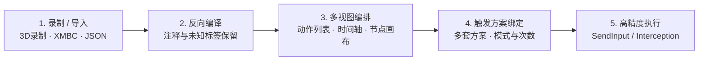

# SuperFaye-Macro

**Windows 键鼠宏编辑器 & 自动化工作台** —— 把「一行宏」变成看得见、改得动的动作序列与节点流程图。

`Rust + WebView2` · `MIT 许可` · `Windows 10 / 11 x64` · `61 项单元测试` · `全离线前端` · [快速开始](#快速开始) · [宏语法](#宏格式参考) · [节点清单](#自动化节点清单)

---

**SuperFaye-Macro** 是一个基于 **Rust + Windows 原生 WebView2** 构建的本地桌面键鼠宏控制台与自动化流程编辑器。  
无需安装 Python 运行时，也无需打开外部浏览器：你录一段真实操作，或者把手里已有的 XMBC 宏串、旧版 JSON 宏丢进去，它就会自动拆开成看得懂、能拖拽编排的动作列表与节点流程图，再配合热键触发方案与底层输入驱动跑起来。



## 它能做什么

<table>
<tr>
<td width="50%" valign="top">

**🎬 录完就能改**  
支持 3D 视角位移（`view`）与键鼠动作同步录制，轨迹与按键可分开保留；采样点过密时支持按预设或自定义管线一键化简、合并。

</td>
<td width="50%" valign="top">

**🧩 动作块 · 组库 · 节点图**  
宏工作台支持动作行、分组与动作块复用；自动化编辑器支持连线画布、注释框、分组折叠、小地图与完整撤销重做。

</td>
</tr>
<tr>
<td width="50%" valign="top">

**🔁 老宏直接搬进来**  
粘贴 X-Mouse Button Control（`{TAG}`）宏串或带注释的 JSON 宏即可一键导入并反向生成节点图；暂无法映射的标签会转为画布注释并提示警告，不静默丢弃。

</td>
<td width="50%" valign="top">

**🎯 触发方案与并发调度**  
支持多套触发方案切换与复制，同一按键可按方案绑定独立宏、执行次数与打断模式（普通 / 暂停 / 按住 / 重启 / 并行），全局 `ESC` 兜底释放全部按键防卡键。

</td>
</tr>
<tr>
<td width="50%" valign="top">

**🔍 看得见的屏幕判断**  
内置屏幕取色、Windows 原生 OCR 识别、多方法图像模板匹配与序列/状态机控制节点，支持框选区域、坐标拾取与面板实时预览。

</td>
<td width="50%" valign="top">

**🤖 AI 助手按需连接**  
内置只读分析与草稿预览机制，可接任意兼容 OpenAI 接口的服务生成或修改宏与流程图；每次修改均先生成改动对比，确认前不会动原文件，且可随时一键撤销。

</td>
</tr>
</table>

---

## 界面导览

主窗口启动后采用**左侧导航 + 顶部遥测栏 + 中央工作区**布局，内置 **纯黑（Black）/ 简约（Snow）/ 纸质（Cream）** 三套主题实时切换：

- **顶部状态条**：实时显示当前运行实例数、全局暂停状态、录制状态及已捕获的动作/轨迹点数。
- **左下角引擎控制坞**：一键开关全局热键监听、触发全局暂停，或立即停止全部运行中的宏。

| 工作区页签 | 主要用途 |
| --- | --- |
| **绑定与方案** | 管理宏文件树、切换/复制触发方案、设置按键触发模式与试跑测试 |
| **宏工作台** | 动作列表编辑、3D/2D 录制与轨迹化简、组合块库、导入 XMBC/JSON 文本 |
| **节点自动化** | 内嵌可视化节点画布编辑器（`automation_editor.html`），支持流程连线、取色找图 OCR 与变量引用 |
| **全局设置** | 调优执行精度、时间轴模式、录制化简管线、快捷键及输入后端，支持配置导入/导出 |
| **系统控制台** | 实时查看执行日志、编译校验提示与异常诊断信息 |

---

## 快速开始

### 运行与构建环境

| 项目 | 要求 |
| --- | --- |
| **操作系统** | Windows 10 / Windows 11（64 位） |
| **桌面运行时** | Microsoft Edge WebView2 Runtime（Windows 11 默认自带；Win10 若缺失可[前往微软官网安装](https://developer.microsoft.com/microsoft-edge/webview2/)） |
| **源码编译工具链** | Rust（`stable-x86_64-pc-windows-gnu`，见 [rust-toolchain.toml](rust-toolchain.toml)）+ WinLibs / MinGW-w64 UCRT64 工具链 |

### 编译与启动

在项目根目录打开终端或直接运行脚本：

```bat
:: 1. 编译 Release 版本，并同步复制 superfaye-macro.exe 与 WebView2Loader.dll 到当前目录
build.bat

:: 2. 启动桌面控制台（若根目录尚无 exe 会先自动触发一次构建）
start.bat
```

只做环境自检（打印后端健康状态 JSON，不弹出桌面窗口）：

```powershell
.\start.bat --check
```

也可以使用 Cargo 直接测试和构建：

```powershell
cargo test
cargo build --release
```

### 三分钟试跑第一条宏

1. 启动程序后，在 **绑定与方案** 左侧点击 **粘文本**，粘贴 `{WAITMS:500}{LMB}` 并保存为一个测试宏。
2. 在右侧选择刚才创建的宏，绑定一个触发键（或直接点击 **试跑一次** 验证运行效果）。
3. 如需真实键鼠按键触发，点击左下角 **启动全局监听**；测试结束后随时按 `ESC` 或点击 **停止全部**。

---

## 进阶参考

<details id="宏格式参考">
<summary><b>📜 宏格式参考</b>（XMBC 标签表 · 原生 JSON 宏行 · 行内注释）</summary>

<br>

### 1. XMBC 宏串

兼容 X-Mouse Button Control 的 `{TAG}` 语法，可与普通按键字符混排：

```text
{LMB}{WAITMS:300}{LMB}
{CTRL}c{WAITMS:80}{CTRL}v
{PRESS}w{WAITMS:500}{RELEASE}w
```

导入反编译可识别的标签分组：

| 分组 | 支持标签 |
| --- | --- |
| **鼠标按键** | `LMB` `RMB` `MMB` `MB4` `MB5` `XMB1` `XMB2` |
| **滚轮** | `MWUP` `MWDN` |
| **修饰键** | `CTRL` `ALT` `SHIFT` `WIN` |
| **时序** | `WAIT` `WAITMS` `HOLD` `HOLDMS` |
| **键码与字符** | `VKC` `SC` `SCE` 及常见键盘字符 |
| **按键状态** | `PRESS` `RELEASE` `CLEAR` |
| **窗口与剪贴板/光标** | `ACTIVATE` `ACTIVATETOP` `POSTWM` `SENDWM` `CURSORBUSY` `CURSORDEFAULT` `CB` |
| **图层与坐标锁定** | `FLUSH` `LAYER` `LOCKX` `LOCKY` `LOCKXY` `UNLOCKX` `UNLOCKY` `UNLOCKXY` `LOCKC` `INVERTX` `INVERTY` `INVERTXY` `OD` `OR` `OU` `EXT` `TILTL` `TILTR` |

> [!NOTE]
> 对于节点画布中没有直接等价动作的扩展标签（如部分图层切换、光标样式或窗口消息标签），反向编译器会生成**黄色注释节点 + 转换警告**，完整保留原宏语义。

### 2. 原生 JSON 宏行

宏文件采用直观的二维 JSON 数组格式，并原生支持 `//` 单行/行尾注释：

```json
[
  // 前置动作示例
  ["kd", "w", 0],
  ["wait", 180],
  ["view", [120, -30], 250],
  ["ku", "w", 20],
  ["md", "left", 0],
  ["mu", "left", 40],
  ["scroll", -3, 20],
  ["loop", 3, [["wait", 100]]],
  ["import", "宏/预设宏/前置动作.json"],
  ["note", "备注文字会保留在编辑器中"]
]
```

常用指令：`kd`（按下键）、`ku`（松开键）、`md`（按下鼠标）、`mu`（松开鼠标）、`wait`（延时 ms）、`view`（视角相对位移）、`scroll`（滚轮）、`loop`（局部循环）、`import`（嵌套引用）、`note`（说明备注）。

</details>

<details id="自动化节点清单">
<summary><b>🧠 自动化节点清单</b>（9 大分类 · 45 处注册 / 43 个独立节点）</summary>

<br>

节点规格声明于 [assets/node_catalog.json](assets/node_catalog.json)，并在 `src/automation/registry.rs` 与 `src/automation/handlers.rs` 中注册与执行（其中 `数学运算` 与 `字符串操作` 在 `variable` 与 `utility` 分类中均有入口）：

| 分类 | 包含节点 |
| --- | --- |
| **flow（流程）** | 开始、结束 |
| **action（动作）** | 鼠标点击、按键动作、鼠标滚轮、文本输入、等待、鼠标移动、相对位移、鼠标按键（原地） |
| **control（控制）** | 条件分支、计数循环、条件循环、等待条件、跳转、序列检测、状态机 |
| **script_block（脚本块）** | 调用宏（同步）、调用宏（异步） |
| **detection（检测）** | 颜色检测、OCR 识别、图像匹配、屏幕状态 |
| **monitor（监视）** | 颜色监视、OCR 监视、定时器 |
| **preset（预设）** | 点击坐标、找图点击、读取数字文本 |
| **variable（变量）** | 设置变量、数学运算、比较、字符串操作、类型转换 |
| **utility（工具）** | 数字常量、字符串常量、布尔常量、数学运算、数学函数、逻辑运算、数值比较、字符串操作、条件选择、延迟、坐标书签 |

</details>

<details>
<summary><b>📁 项目结构</b></summary>

<br>

```text
├── Cargo.toml / Cargo.lock      Rust 工程依赖清单与锁定版本（edition 2024）
├── rust-toolchain.toml          固定目标工具链（stable-x86_64-pc-windows-gnu）
├── build.rs / build.bat         Windows 图标资源嵌入与 Release 构建脚本
├── start.bat                    桌面端启动器（支持 --check 健康自检）
├── assets/
│   ├── param_defaults.json      全局参数 Schema、字段文档与空白安全默认值
│   ├── key_catalog.json         键位与扫描码目录
│   ├── metadata_catalog.json    前端下拉枚举与说明元数据
│   └── node_catalog.json        自动化编辑器节点定义
├── src/
│   ├── main.rs                  程序入口与 `--smoke-health` 自检模式
│   ├── webview_host.rs          tao + wry WebView2 桌面容器与受限静态资源协议
│   ├── core/                    路径安全隔离、环形日志控制台与统一响应结构
│   ├── bridge/                  前端 JS ↔ Rust IPC 分发、宏管理、方案与参数存储
│   ├── engine/                  全局热键钩子、坐标系、自适应补偿与 SendInput/Interception
│   ├── executor/                宏编译优化、多方案调度与防卡键停止器
│   ├── macro_io/                带注释宏解析、宏树扫描与 XMBC 反向编译
│   ├── recorder/                3D 轨迹+动作双轨录制与 RDP/意图化简工具
│   ├── automation/              节点图编译校验、执行引擎、取色/模板匹配/WinRT OCR
│   ├── assistant/               AI 接口管理（SSRF/TLS 校验）、沙箱工具、草稿与 SQLite 历史
│   └── release_safety_tests.rs  发布安全回归测试集
└── webui/                       全离线控制台与节点图编辑器前端资源（含本地 Font Awesome 6.5.0）
```

</details>

---

## 安全与离线保证

- **开箱空白配置**：仓库不包含任何个人宏、自动化脚本、本机绝对路径、账号凭据或默认启用的代理地址；默认 `USE_INTERCEPTION* = false`、`MACRO_BINDINGS = {}`。
- **AI 接口与密钥隔离**：远程模型接口强制 `https://`（仅允许 `127.0.0.1` / `localhost` / `::1` 使用 `http://`），禁止 URL 内嵌账号密码或查询参数，阻止重定向跳转；界面输入的 API Key 仅驻留内存，不落盘，也支持通过环境变量 `MACRO_AI_BASE_URL`、`MACRO_AI_API_KEY` 注入。
- **全离线前端与 CSP**：主控台与节点图编辑器完全移除第三方 CDN（Google Fonts / cdnjs），图标字体与样式全部本地打包于 [webui/vendor/fontawesome/](webui/vendor/fontawesome/)，HTML 页面启用严格 `Content-Security-Policy` 并消除内联事件拼接。
- **文件系统边界隔离**：所有宏读写、节点脚本存取（限 `自动化脚本/*.auto.json`）、模板读取（限 `图片模板/` 与 `appdata/templates/`）与 WebUI 资源加载均经过 `AppPaths` 路径规范化与目录边界检查，拒绝 `..`、绝对路径逃逸、备用数据流（ADS `:`）、Windows 保留设备名（`CON`/`NUL` 等）及符号链接/重解析点。

---

## 测试

项目共内置 **61 项单元测试**（基于合成数据与临时隔离目录运行，不依赖真实宏文件或外部网络）：

```powershell
cargo test
```

测试覆盖：`AppPaths` 安全隔离、自动化脚本与模板边界限制、宏递归循环与化简约束、全局参数编解码、`SendInput` 与 `Interception` 扫描码对齐、触发并发模式、XMBC 反向编译、AI SSRF 拦截与会话压缩、WebUI CSP 与默认值检查。

---

## 管理员窗口与可选 Interception 驱动

- **权限对等**：若目标游戏或软件以管理员身份运行，需以同样权限运行本程序才能向其发送输入事件。
- **Interception 驱动（可选）**：默认使用系统原生 `SendInput`，无需安装额外驱动。确需使用底层硬件驱动时：
  1. 请自行从 [Interception 官方发行页](https://github.com/oblitum/Interception/releases) 下载安装并重启系统；
  2. 将 `interception.dll` 放置于项目根目录下的 `Interception/library/x64/interception.dll`；
  3. 在 **全局设置** 中手动开启对应的 Interception 总开关 / 键盘 / 鼠标开关。

---

## 本地数据目录

以下文件与目录均已列入 [.gitignore](.gitignore)，仅保存于用户本地运行环境，不会进入代码仓库：

| 数据类型 | 本地路径 |
| --- | --- |
| 宏文件与录制输出 | `宏/` |
| 自动化节点图脚本 | `自动化脚本/` |
| 图像识别模板 | `图片模板/` |
| 全局参数 / 方案 / 分组库 / AI 配置 | 根目录 `webui_param_config.json`、`webui_schemes.json`、`webui_group_lib.json`、`webui_ai_config.json` |
| WebView2 缓存与助手对话库 | `appdata/webview/`、`appdata/assistant-history.sqlite3` |
| 运行日志 | `logs/` |

---

## 常见问题

<details>
<summary><b>编译时报找不到 gcc / ld 或工具链错误</b></summary>

<br>工程使用 `stable-x86_64-pc-windows-gnu` 目标工具链，需要 MinGW-w64 UCRT64（如 WinLibs）。[build.bat](build.bat) 会自动探测常见 WinLibs 目录并加入临时 `PATH`；若自行安装了 `mingw64`，请确保其 `bin` 目录及 `%USERPROFILE%\.cargo\bin` 在当前终端 `PATH` 中。

</details>

<details>
<summary><b>启动时白屏或提示 WebView2 初始化失败</b></summary>

<br>系统缺少微软 Edge WebView2 运行时，下载并安装一次官方 [WebView2 Runtime](https://developer.microsoft.com/microsoft-edge/webview2/) 即可恢复正常。

</details>

<details>
<summary><b>触发热键正常，但目标窗口内没有按键反应</b></summary>

<br>通常有两种原因：① 目标窗口以管理员权限启动，而本程序处于普通权限；② 目标窗口拦截了软件模拟输入，此时需按上方说明安装并启用 Interception 驱动。

</details>

<details>
<summary><b>如何使用 AI 草稿助手？</b></summary>

<br>本仓库默认不预设任何服务地址。点击界面内的 AI 面板设置，填入你自己的 OpenAI 兼容服务地址（远程服务需 `https://`，本机服务如 Ollama 等可用 `http://127.0.0.1:端口/v1`）并刷新选择模型即可开始对话。

</details>

---

## 致谢与开源许可

- 本项目基于 [MIT License](LICENSE) 开源（Copyright (c) 2026 YS14）。
- 最初思想与部分功能设计源自 [Masclrin/MacroDriver-WebUI](https://github.com/Masclrin/MacroDriver-WebUI)。本仓库的 MIT 许可适用于本仓库独立编写及重构的全部 Rust / 前端代码；原上游仓库未显式声明开源协议，涉及原上游原始代码部分请按[上游仓库说明](https://github.com/Masclrin/MacroDriver-WebUI/blob/716160d3cd25631dadd788a49045651620e73883/README.md)遵守相应版权归属。
- 前端本地打包使用了 Font Awesome Free 6.5.0 图标样式与字库，授权协议见 [webui/vendor/fontawesome/LICENSE.txt](webui/vendor/fontawesome/LICENSE.txt)。

> [!WARNING]
> 自动化与键鼠宏工具会改变目标程序的行为，请仅在具备合法使用权限的本地或测试环境中使用，并自行遵守相关软件与服务条款。
