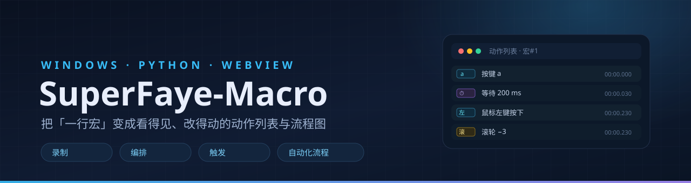
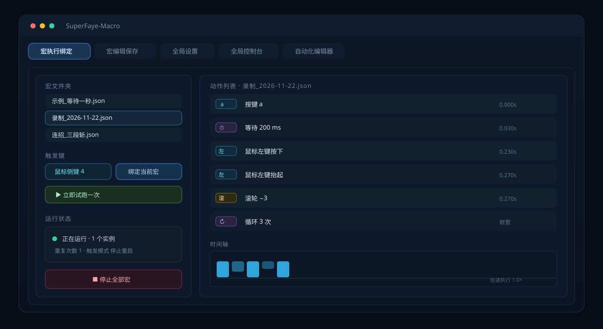

<div align="center">
  
</div>

<div align="center">

[](LICENSE)
[](#环境要求)
[](#环境要求)
[](#测试)
[](https://github.com/YSER14/SuperFaye-Macro/commits/main)

</div>

<br>

**SuperFaye-Macro** 是一个跑在 Windows 本地的键鼠宏编辑器。你录一段操作，或者把手里已有的 XMBC 宏串、旧版 JSON 宏丢进去，它会把这一串动作摊开成能看、能改、能拖的列表与流程图，再绑到某个键上一键跑起来。

界面是本地 WebView 窗口，不用开浏览器，也不用联网。


---

## 它解决什么问题

宏这东西，平时都是一行魔法：`{FLUSH}{LMB}{WAITMS:300}{LMB}`。改个等待时间要数括号，想加个判断得重写，过两周自己也看不懂。

SuperFaye-Macro 把这层拆开——三种视图（动作块 / 时间轴 / 节点画布）看同一份数据，改哪都行；手上的老宏不用重画，导入就变成图；跑起来之后随时能停、能接管。

<table>
<tr>
<td width="50%" valign="top">

<b>🎬 录完就能改</b><br>
录制真实操作生成动作列表，轨迹与按键可分开保留，采样点太多就一键化简合并。

</td>
<td width="50%" valign="top">

<b>🧩 三种视图一份数据</b><br>
动作块、时间轴、节点画布随意切换，拖拽排序、成组、撤销重做都跟着走。

</td>
</tr>
<tr>
<td width="50%" valign="top">

<b>🔁 老宏直接搬进来</b><br>
XMBC 的 <code>{TAG}</code> 串和旧 JSON 宏一键反编译成节点图，表达不了的部分转成注释加警告，不偷偷丢掉。

</td>
<td width="50%" valign="top">

<b>🎯 触发与执行分开管</b><br>
多套绑定方案互不干扰，每个绑定设重复次数和触发模式，<code>停止全部宏</code> 兜底防卡键。

</td>
</tr>
<tr>
<td width="50%" valign="top">

<b>🔍 看得见的条件判断</b><br>
取色、找图、OCR、序列检测做成节点，配合循环与等待，做轮询和条件触发。

</td>
<td width="50%" valign="top">

<b>🤖 AI 只在你叫它时上线</b><br>
接任意 OpenAI 兼容接口生成草稿；默认上下文为「无」，密钥只在内存里，不落盘。

</td>
</tr>
</table>

## 界面

<div align="center">
  
  <sub>界面示意图，真实样式以本地运行为准</sub>
</div>

<br>

窗口顶部五个页签：

| 页签 | 干什么 |
| --- | --- |
| **宏执行绑定** | 选宏、设触发键、试跑、看运行状态，启动/停止全局监听 |
| **宏编辑保存** | 动作列表、动作块库、时间轴、录制与轨迹化简 |
| **全局设置** | 参数、输入后端、精度选项 |
| **全局控制台** | 运行日志与错误输出 |
| **自动化编辑器** | 节点画布，编排带分支、循环和检测的流程 |

## 快速开始

### 环境要求

| 项目 | 要求 |
| --- | --- |
| 系统 | 64 位 Windows 10 / 11 |
| Python | 64 位 **CPython 3.12**（3.11 及以下、32 位都不行） |
| 运行时 | Microsoft Edge WebView2 Runtime（Win11 自带） |
| 网络 | 只有第一次装依赖需要 |

### 启动

在项目目录用**普通权限**打开 PowerShell：

```powershell
.\start.bat
```

第一次运行它会做三件事：找 64 位 Python 3.12 → 在 `%LOCALAPPDATA%\SuperFaye-Macro\runtime-<哈希>` 建独立环境 → 按 `bin/requirements.txt` 装依赖（每个包带 SHA-256 哈希校验，慢是正常的）。

只准备环境、不启动界面：

```powershell
.\start.bat --check
```

### 三分钟试跑第一条宏

1. 进 **宏执行绑定 → 导入宏文本**，粘贴 `{WAITMS:1000}`（就是等 1 秒）。
2. 选中生成的宏，填个触发键，点 **绑定当前宏**，再点 **立即试跑一次**。
3. 想用真实键鼠触发，点侧栏 **启动全局监听**；完事点 **停止全部宏**。

想改动作就进 **宏编辑保存**：用 `导入现成宏` 加进列表，改完 `保存当前宏`。

---

<details>
<summary><b>📜 宏格式参考</b>（XMBC 标签表 · 原生 JSON 行）</summary>

<br>

### XMBC 宏串

按 X-Mouse Button Control 的 `{TAG}` 语法写，可混排普通字符：

```text
{LMB}{WAITMS:300}{LMB}
```

```text
{CTRL}c{WAITMS:10}d
```

`{PRESS}` / `{RELEASE}` 修饰**下一条**按键，用来做按住：

```text
{PRESS}a{WAITMS:200}{RELEASE}a
```

导入时能识别的标签：

| 分组 | 标签 |
| --- | --- |
| 鼠标按键 | `LMB` `RMB` `MMB` `MB4` `MB5` `XMB1` `XMB2` |
| 滚轮 | `MWUP` `MWDN` |
| 修饰键 | `CTRL` `ALT` `SHIFT` `WIN` |
| 时序 | `WAIT` `WAITMS` `HOLD` `HOLDMS` |
| 键码 | `VKC` `SC` `SCE`，以及普通字符键 |
| 按键状态 | `PRESS` `RELEASE` `CLEAR` |
| 窗口与光标 | `ACTIVATE` `ACTIVATETOP` `POSTWM` `SENDWM` `CURSORBUSY` `CURSORDEFAULT` `CB` |
| 图层与锁定 | `FLUSH` `LAYER` `LOCKX` `LOCKY` `LOCKXY` `UNLOCKX` `UNLOCKY` `UNLOCKXY` `LOCKC` `INVERTX` `INVERTY` `INVERTXY` `OD` `OR` `OU` `EXT` `TILTL` `TILTR` |

其中 24 个标签（窗口激活、光标状态、图层切换、坐标锁定与反转、倾斜滚轮等）在节点图里没有等价动作，导入后会变成**画布注释 + 警告**，保留原意而不是假装成功。

### 原生 JSON 宏行

一行一个动作，`import` 可以嵌套别的宏：

```json
[
  ["kd", "a", 0],
  ["ku", "a", 30],
  ["wait", 200],
  ["md", "left", 0],
  ["mu", "left", 40],
  ["view", [120, -40], 500],
  ["scroll", -3, 20],
  ["loop", 3, [["wait", 100]]],
  ["import", "公共/常用前置宏.json"],
  ["note", "这一段是说明文字"]
]
```

指令：`kd` `ku` `md` `mu` `wait` `view` `scroll` `loop` `import` `note`。

</details>

<details>
<summary><b>🧠 自动化节点清单</b>（9 类 43 个）</summary>

<br>

节点定义在 `automation/nodes/`，注册进 `automation/registry.py`。`数学运算` 与 `字符串操作` 在变量、工具两类下各注册一次，所以是 45 处注册、43 个不同节点。

| 分类 | 节点 |
| --- | --- |
| **flow** 流程 | 开始、结束 |
| **action** 动作 | 按键动作、文本输入、鼠标移动、鼠标点击、鼠标按键（原地）、鼠标滚轮、相对位移、等待 |
| **control** 控制 | 条件分支、计数循环、条件循环、等待条件、跳转、序列检测、状态机 |
| **variable** 变量 | 设置变量、数学运算、字符串操作、比较、类型转换 |
| **utility** 工具 | 数字常量、字符串常量、布尔常量、数学函数、数学运算、逻辑运算、数值比较、字符串操作、条件选择、延迟、坐标书签 |
| **preset** 预设 | 点击坐标、找图点击、读取数字文本 |
| **script_block** 脚本块 | 调用宏（同步）、调用宏（异步） |
| **detection** 检测 | 图像匹配、颜色检测、OCR 识别、屏幕状态 |
| **monitor** 监视 | 颜色监视、OCR 监视、定时器 |

节点图存成 JSON（`meta` / `variables` / `settings` / `graph`），能进版本管理。

</details>

<details>
<summary><b>📁 项目结构</b></summary>

<br>

```text
start.bat                启动入口：找 Python、建环境、装依赖、拉起界面
3_启动webui.bat          同上，快捷转发
webui_app.py             pywebview 窗口 + 本地服务，挂各 bridge API
宏执行框架3.2.py          单文件宏执行核心：触发监听、播放、ESC 终止
automation/              节点注册表、图编译器、执行引擎、检测、测试
  nodes/                 9 类节点的定义与处理
  handlers/              执行处理器
  detection/             图形、颜色、OCR、序列检测
  tests/                 101 项单元测试
bridge/                  WebView 与后端之间的接口层
core/                    路径、参数、响应封装、AI 模型客户端
engine/                  输入后端（SendInput / Interception）、坐标、精度
macro_io/                宏解析、反向编译、宏树读写
recorder/                录制、轨迹化简、3D 视角记录
webui/                   前端页面与模块、图标字库
bin/                     依赖哈希清单与驱动安装脚本
docs/                    README 用的图
```

</details>

## 测试

101 项单元测试，基于标准库 `unittest`，跑在合成数据上，不需要真实键鼠。

```powershell
.\start.bat --check
$py = Get-ChildItem "$env:LOCALAPPDATA\SuperFaye-Macro\runtime-*\Scripts\python.exe" | Select-Object -First 1 -ExpandProperty FullName
& $py -m unittest discover -s automation/tests -t . -v
```

覆盖图编译器、执行引擎与处理器、宏触发、键盘播放、反向编译、AI 草稿和发布安全检查。AI 草稿那 13 项依赖 `pydantic-ai`，其余 100 项不装第三方包也能过。

## 常见问题

<details>
<summary><b>提示找不到 Python 3.12</b></summary>

<br>装 64 位 CPython 3.12 后重开终端。脚本会依次试 `py -3.12`、`python`、`python3`、常见安装路径和 `uv` 的 Python 目录。

</details>

<details>
<summary><b>装依赖时报「请先用普通权限运行 start.bat --check」</b></summary>

<br>说明你在管理员窗口里，而且环境还没装全。关掉管理员窗口，普通权限装完依赖，再按需提权启动。

</details>

<details>
<summary><b>提权后按键没反应</b></summary>

<br>目标窗口和 SuperFaye-Macro 的权限得一致。保护类窗口还得启用 Interception 后端。

</details>

<details>
<summary><b>窗口白屏</b></summary>

<br>缺 WebView2 Runtime，装一次 [WebView2 Runtime](https://developer.microsoft.com/microsoft-edge/webview2/) 就好。

</details>

<details>
<summary><b>想彻底重置环境</b></summary>

<br>删掉 `%LOCALAPPDATA%\SuperFaye-Macro\` 下对应的 `runtime-<哈希>` 目录，重新跑 `start.bat`。

</details>

## 管理员窗口与 Interception

目标窗口如果是管理员权限运行的，先**用普通权限**跑完 `.\start.bat --check`（装依赖别提权），再按需以管理员身份启动，否则两边权限不对等，按键发不出去。

Interception 驱动默认关闭，要开的话：

1. 从 [Interception 官方发行页](https://github.com/oblitum/Interception/releases) 下载解压，让安装器落在 `Interception/command line installer/install-interception.exe`。
2. 以管理员身份运行 [驱动安装脚本](bin/安装驱动_管理员运行_l.bat)，按提示重启。
3. 在 **全局设置** 里启用 Interception，键盘和鼠标驱动可以分开开关。

驱动目录和二进制不进版本库，需要自己下。

## 本地数据

| 数据 | 默认位置 |
| --- | --- |
| 宏文件与录制 | `宏/` |
| 自动化流程 | `自动化脚本/` |
| 设置、绑定方案、宏组库、AI 连接 | 项目根目录下各自的 `webui_*.json` |
| WebView 存储 | `appdata/webview/` |
| 运行日志 | `logs/` |

以上默认都在 `.gitignore` 里。录制时避开密码之类的输入；分享宏之前，留意里面的文字、路径、窗口标题。

## 参与开发

- 新增节点：在 `automation/nodes/` 写定义和处理函数，注册进 `registry.py`，补一条流程测试。
- Python 侧跟 PEP 8，前端是原生 ES Module，不引入构建链。
- 动执行核心记得跑完整单测；改输入后端建议在虚拟机或独立账号里验证。

## 致谢与许可

本项目以 [MIT 许可证](LICENSE)发布，版权归 YS14。

项目基于 [Masclrin/MacroDriver-WebUI](https://github.com/Masclrin/MacroDriver-WebUI) 开发。上游仓库没有声明适用许可证，所以这里的 MIT 只覆盖本项目自己改的和新增的部分，不改变上游代码的版权归属；商用或再分发上游代码请先取得上游作者授权（[上游 README](https://github.com/Masclrin/MacroDriver-WebUI/blob/716160d3cd25631dadd788a49045651620e73883/README.md)）。

前端图标用 Font Awesome Free 6.5.0 本地样式与字库，附带其[许可证](webui/vendor/fontawesome/LICENSE.txt)。

## 使用提醒

宏会改变别的软件的行为。只在自己有权限的环境里用，遵守目标程序和平台的服务条款；用出问题的后果自己承担。
